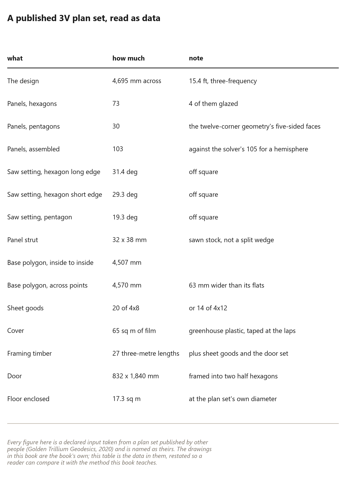
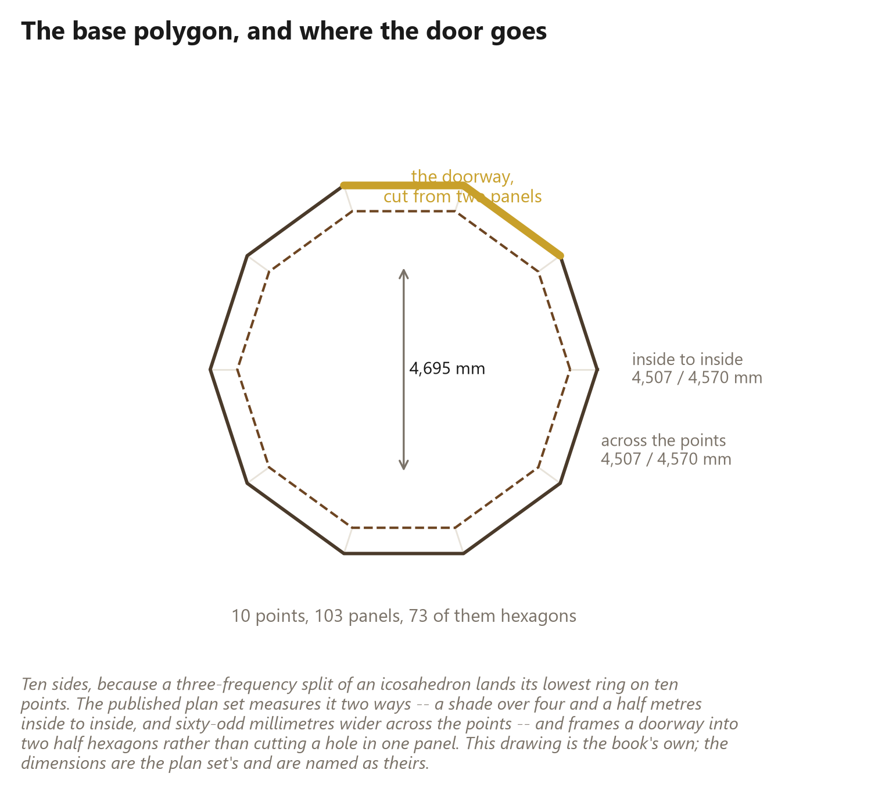

# 88. The Tried and True Dome

*The popular three-frequency panel dome, solved by this book's own code and set beside the wedge dome for comparison*

One of the most popular small domes people build is a three-frequency shell,
cut five-eighths of the way down, framed as panels of sawn sticks on a jig. It
is tried and true: a great many of them are standing, as cabins, studios,
greenhouses and guest rooms. That makes it the best comparison this book's
method has, and this chapter sets it beside the wedge dome.

Nothing here is copied from anybody's plans. The dome is solved by this
project's own code (`panel_method.py`) at a {{plan.diameter_ft}} foot base, a
size chosen for this book, and the drawings are this book's own.

## The dome, solved

Read as a census, that is the whole design: a {{plan.diameter_m}} metre shell of
**{{plan.panels}} panels** -- {{plan.hex_panels}} that belong to hexagons and
{{plan.pent_panels}} that belong to the twelve pentagons -- standing
{{plan.height_m}} metres tall, its height {{plan.fraction}} of its width. Every
panel is one of two triangles, and every stick is a {{plan.strut_mm}} by
{{plan.strut_depth_mm}} millimetre half of a ripped 2x3.

Three figures in that table decide the work.

**The sticks are pinwheeled, so equal sides are not equal sticks.** Each stick
runs to one corner and butts the next at the other. That gives the dome
{{plan.distinct}} distinct sticks, not three -- {{plan.sticks}} in all -- with tail
cuts of {{plan.miter_hex_short}} and {{plan.miter_hex_long}} degrees on the
hexagon panels and {{plan.miter_pent}} and {{plan.miter_pent_long}} on the
pentagon panels.

**One bevel cannot be exact.** The panels turn by different amounts where they
meet, so the exact bevel on a stick runs from {{plan.bevel_lo}} to
{{plan.bevel_hi}} degrees. A shop rips every stick at one setting, and a bead of
sealant or a gasket between frames takes up the difference.

**And the skin goes on in sections.** {{plan.sections_pent}} pentagons and
{{plan.sections_hex}} hexagons come out whole at this cut, each skinned in one
sheet, so a torn section is one section to replace.

## A base that zig-zags

The geometry worth pausing on is the base. A three-frequency sphere has no level
ring of points at its middle, so the cut goes lower, and the bottom edge it
leaves -- {{plan.base_edges}} edges -- does not lie on one level. Its corners
alternate between two heights {{plan.taper_mm}} millimetres apart. So
**{{plan.tapered}} base sections are tapered** and {{plan.level}} sit level.

The census checks itself: the cut keeps {{plan.solver_panels}} faces,
{{plan.solver_struts}} edges and {{plan.solver_hubs}} points, and the whole
sphere has only {{plan.solver_classes}} chord lengths. The pentagons are where
the icosahedron's twelve corners were, as they are in every geodesic dome.

## What this method buys and what it costs

The honest comparison, in the terms this book has used throughout.

**What it buys.** A method you can start tomorrow. The stock is at the yard, the
tool list is a table saw, a miter saw, a drill and clamps, and the panels are
built indoors at a bench, finished and skinned before they leave the shop. A
first-time builder can make a dry {{plan.area_sqm}} square metre room with it.
That is why so many have.

**What it costs.** The wood is bought, so this book's whole recovery argument
does not apply: every stick is sawn, dried, graded and delivered. There are many
more pieces -- {{plan.sticks}} sticks against the wedge dome's members -- and
more kinds of them. And a film-covered shell is a greenhouse in July unless
somebody details it.

**And what it shares with this book's method.** The panel is the unit of work,
the jig holds the geometry so the builder does not have to, the angles live in
the parts rather than in a hub, and the frame is allowed to be rough because the
skin closes it. A reader who has understood those four sentences has understood
the important part of either method.

## What a reader may take from it

**Take the jig discipline.** Drawing the panel full size from three lengths, and
letting rails hold every stick on its line, is the same idea as this book's own
jig, applied to sawn stock.

**Take the sections.** Skinning a whole pentagon or hexagon in one sheet is a
good habit wherever a skin goes on in pieces.

**Take the loose assembly.** A shell screwed together loosely until the last
panel closes it, then tightened, is easier to build and truer when done.

**And keep this book's method where it differs.** The wedge dome starts from
trees, carries its angles in the shape of the stick, and has fewer, bigger
pieces. The tried-and-true dome starts from a lumber yard. Both end in a dome;
choose by what you have.
