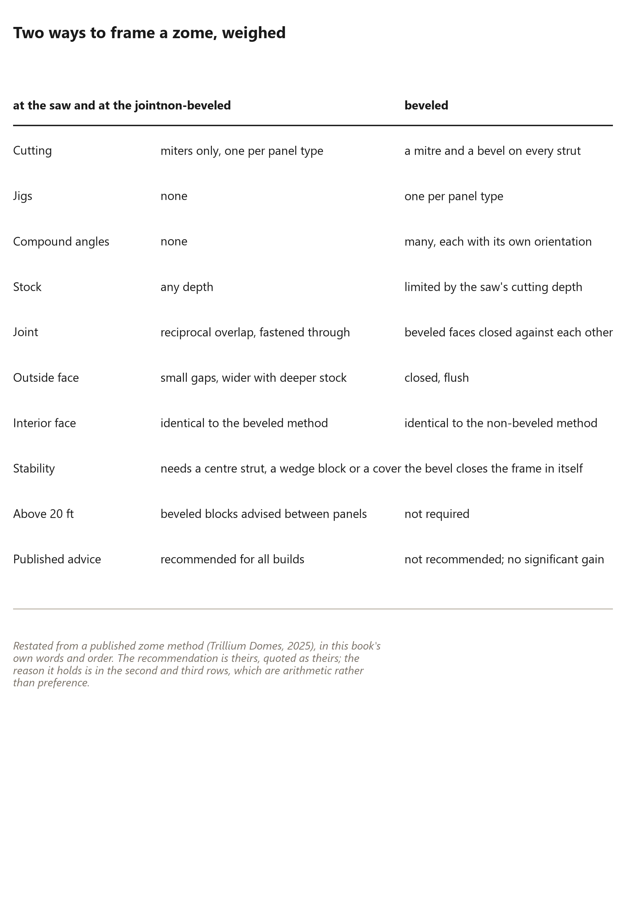
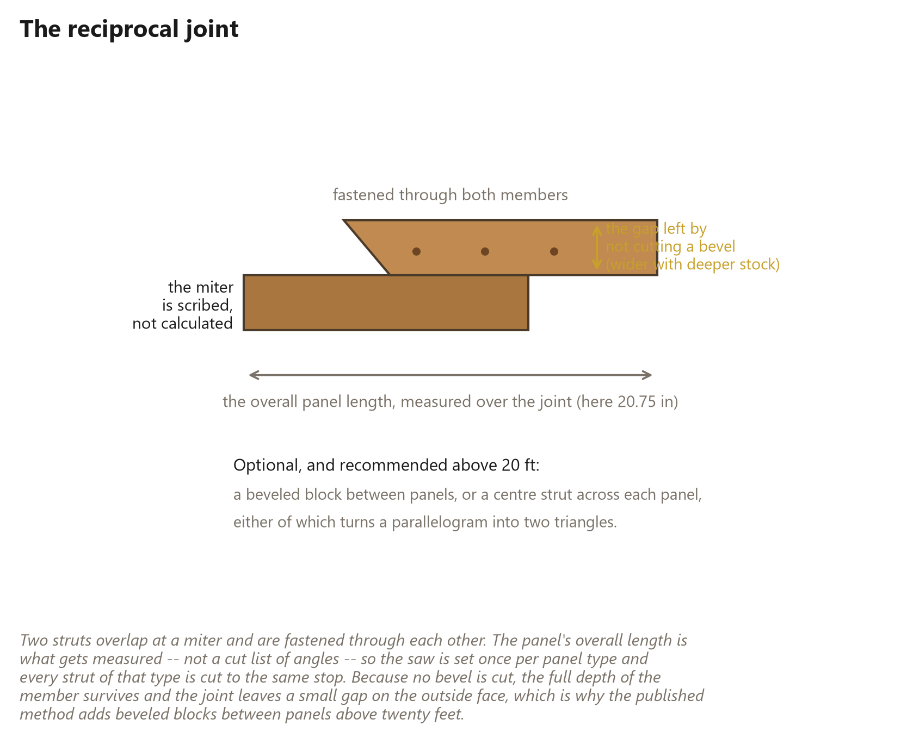

# 89. The Non-Beveled Method

*How a zome is actually framed: two customary methods, one of which needs no compound cuts at all, and the sequence that makes it work*

The zome chapter described the shape. This chapter is the *method*: how a
working shop actually frames one, and why the version that looks lazier is the
better one. The example is this book's own nine-sided zome, solved by
`panel_method.py`: {{zome.panels_nine}} panels in {{zome.rows}} rows of
{{zome.per_row}}, {{zome.struts_nine}} struts and {{zome.hubs_nine}} corners,
every panel side {{zome.side_in}} inches.

## Two ways to frame a zome, weighed

The two customary methods differ in one decision: whether the struts are
beveled where they meet, or simply mitered and overlapped.

**The non-beveled method** leaves the members square in section. Two struts meet
at a miter, overlap, and are fastened through one another — a reciprocal joint.
Because no bevel is cut, the member keeps its full depth at the joint, the saw
work is one miter per panel type, and no jig is needed beyond a stop block. The
cost appears on the outside face: where the two members rotate into their panel
angle, their outer edges stand apart by the bevel that was never cut, leaving a
small gap that widens with the depth of the member.

**The beveled method** rips the bevel onto one side of every strut so the
members close against each other. The outside face comes out flush and the joint
is closed in itself, at the price of a compound cut at every intersection with
its own orientation, a jig per panel type, and a member depth limited by what
the saw can cut.

Builders who have framed zomes both ways overwhelmingly choose the
non-beveled method, and the arithmetic supports them: the difficulty of the
beveled method buys a flush outside face and nothing else, while its depth limit
costs strength. The second and third rows of that table are the whole argument,
and they are not a matter of taste.

## The reciprocal joint

The joint is the method, so it is worth describing precisely. Two struts are
mitered at their ends, laid so they overlap, and fastened through both members
with structural screws sized for the load.

What is *measured* is the panel's overall length — {{zome.side_in}} inches on
this book's zome — taken across the overlap rather than along one member. The angles are **scribed** rather than calculated: the first miter is
cut on two struts, they are butted together on the bench, the overall length is
marked from the plan, and the second miter is marked off that line. Then a stop
block is set and every strut of that panel type comes off the saw identical.

Which is the whole reason the method is fast. A cut list of angles is replaced by
one measurement and one stop block per panel type; the fabricator is not solving
a compound angle, they are copying a mark.

The gap that result leaves is worth understanding rather than hiding, because
its size is predictable: it is the bevel the joint is missing, twice the depth
of the member times the tangent of half the fold, so it grows with the depth. In
a {{zome.depth_in}} inch deep member on this book's zome it opens from
{{zome.gap_lo_in}} to {{zome.gap_hi_in}} inches. On a small zome that is a seam a
covering laps over without noticing; on a large one, bevelled blocks between the
panels fill it.

## The sequence, as a shop would run it

In the order this book would teach it, with the reasoning attached to each:

1. **Clear the bench and rip the stock.** Rip first, because every later
   measurement is taken from a face. Rough-cut to the panel length if it helps;
   the joints will trim a little off each piece anyway.
2. **Cut the first miters.** Two struts, one panel type, the angle set with a
   digital finder. If the saw will not reach the angle, an auxiliary fence
   bolted to the bench gives the rest of it — the same remedy this book's cut
   chapter recommends when a miter saw runs out of scale.
3. **Mark the overall length over the joint.** Struts butted and overlapping,
   the plan's panel length marked from the correct reference, never from the end
   of one member.
4. **Scribe the second miter.** Long point to short point, on the mark, with the
   angle finder.
5. **Cut to a stop block.** Set the stop once and cut every strut of that type
   the same way, front to back, out of full-length stock.
6. **Check the overall dimension before cutting the batch.** Assemble two
   struts, measure the panel length, adjust the stop, recut. This check
   comes *before* the pile is cut -- the same discipline as this book's
   dry-fit-one-triangle rule.
7. **Build pairs, then halves, then panels.** Pairs make panels; partial
   panels need halves, and a half is made by cutting the middle strut and
   lining it up with the corners of a full panel to mark it.
8. **Add the middle strut to each panel.** This is the step that turns a
   parallelogram into two triangles. It is optional once a structural covering
   is on, and not before.
9. **Assemble with the joinery loose until it sets itself.** Two fasteners per
   strut, placed toward the inside edge, not overtightened: the panels are meant
   to hinge a little as they are lined up, because the bevel angle between
   panels then sets itself. Bevel blocks, where they are used, act as the gauge.
10. **Then go back and finish the fastening.** Once everything is closed, the
    rest of the screws go in, evenly along every strut.

Two of those steps are the method's real content, and both are habits rather
than tricks: **measure the assembly rather than the part** (step 3), and **leave
the frame loose until the geometry closes it** (step 9). A builder who
understands why those two work can frame a zome from any set of panel
dimensions, which is a more transferable possession than any particular plan.

## The stability the shape does not have

A zome's panels are parallelograms, and a parallelogram is a mechanism: it
changes shape without any of its sides changing length. This book's rigidity
argument — the one it makes about triangles on its second page — is exactly why
a zome is *less* stable than a geodesic dome of the same size.

The remedies are the ones the geometry implies:

**A centre strut across each panel.** One member from corner to corner converts
the parallelogram into two triangles and the mechanism into a frame. It costs a
strut per panel and adds nothing to the shell's area.

**Or a diaphragm.** A structural covering — plywood, polycarbonate, even a
tightly laced fabric — does the same job and is often cheaper than the strut,
which is why either will do. The cover is part of the
structure in a zome, not decoration on it, and a reader who takes one thing from
this chapter should take that.

**And bevel blocks on a big zome.** The blocks that close the outside gap also
brace the joint, so the detail that is cosmetic on a small zome becomes
structural on a large one. That is a rare and satisfying thing in building: the
same small piece of wood doing two jobs at once.

## Covering, and the one rule

Covering a zome reduces to a single rule that matters more than the material:
**every panel laps over the one below it.** A zome's panels share
a consistent up-and-down orientation, so a shell can be shingled with almost
anything — rigid polycarbonate overlapping at each seam, sheet metal, membrane,
or conventional roofing over a plywood deck. A conventional assembly runs
framing, deck, flashing, underlayment, roofing; an insulated one can have its
gaps between panels foamed, which air-seals and insulates in the same pass.

Read against this book's weather chapter, the zome is the easier shell: no seam
key, no channel, no fold angle varying across the building. Every panel edge is
the same lap detail at the same angle, all the way up. That is a genuine
advantage, and it is why a zome takes an opening as a whole panel left out and
framed, with the lap continuing around it.

## Where this leaves the book's own method

Two variation chapters, one conclusion, stated without favouritism.

**A zome makes a better room.** Its walls are vertical where a dome's are not,
its parallelograms take furniture and windows and doors the way a wall should,
its panels are flat so a covering laps without geometry fights, and its hubs
land on level rings by construction.

**A dome makes a better shell.** Its triangles are rigid without a centre strut
or a diaphragm, its struts are one length and one miter for the whole building,
and its load path is closed by geometry rather than by the covering.

Which one a reader wants depends on which half of that sentence matters more,
and the honest answer for most small buildings is that a zome is the easier
first build while this book's wedge dome is the better second one. The method in
this book exists because its author had trees; the method in this chapter exists
because its author had a saw and a yard. Both are legitimate reasons to start,
and neither is a reason to sneer at the other.

That is the whole of what this pair of chapters has to say about other ways of
doing it. The rest of this book is one method, taught properly, with its numbers
computed. These pages are the map of where it sits.
