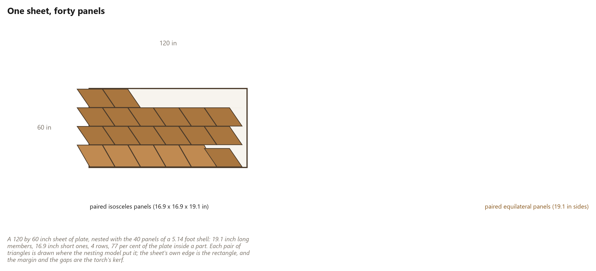
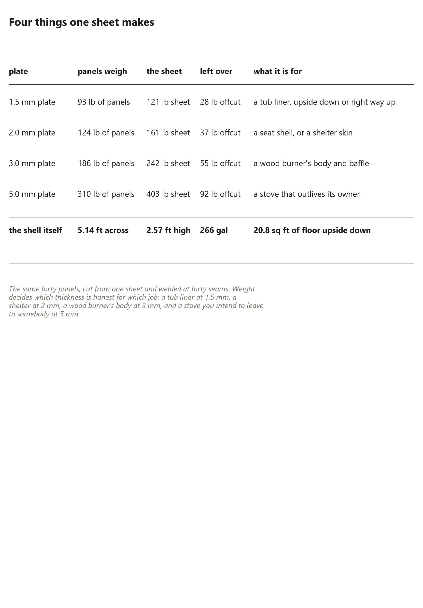

# 90. One Sheet, Forty Panels

*What a {{plate.sheet_in}} inch sheet of plate becomes when a plasma torch cuts the whole shell's panels out of it: a {{plate.diameter_ft}} foot vessel, forty panels, {{plate.gal}} gallons, and an afternoon of welding*

Every chapter before this one has treated the frame as the building and the
skin as something bought. This chapter reverses the habit: the panels are the
structure, the sheet is the material, and the cutting table turns one into the
other.

It works because the arithmetic of the shell does not change. Forty panels is
forty panels whether they are wedge-cut from a tree or torched from a sheet:
thirty isosceles triangles and ten equilateral ones, the same two frequencies
making the same hemisphere. What changes is the material and the joint -- a
welded butt instead of a seam key, a sheet instead of a tree -- and it happens
that the sheet is the same size as the table's bed.

## The nest

The nest is this book's own computation, and it is built the way a person with
soapstone and a straight edge would lay a sheet out: in **strips** of triangles
pointing alternately up and down. A strip of alternating triangles tiles with
nothing between neighbours but the cutting gap, so the only waste is at the
ends of the strips and above the shorter ones.

Every panel is slid along its strip until the real distance to its neighbour is
exactly the gap -- not a guess at the spacing, the distance itself -- and when
the sheet is full the layout is checked part by part: inside the margin, and no
two parts closer than the gap. The panels come from the solved dome, not from a
table of factors, so a change to the geometry changes the nest.

At the largest size that passes, the numbers are:

| the sheet | |
|---|---|
| Sheet | {{plate.sheet_in}} inches |
| Panels cut from it | {{plate.panels}} |
| Long side | {{plate.long_in}} inches |
| Short side | {{plate.short_in}} inches |
| Strips | {{plate.rows}} |
| Plate inside a part | {{plate.util_pct}} per cent |
| Torch path | {{plate.cut_ft}} feet, about {{plate.cut_minutes}} minutes |
| Parts, in 3 mm steel | {{plate.part_lb}} lb |
| The whole sheet weighs | {{plate.sheet_lb}} lb |
| Offcut | {{plate.offcut_lb}} lb |

That is the honest reading of *the largest forty panels one sheet can carry*: a
shell **{{plate.diameter_ft}} feet across and {{plate.height_ft}} feet high**,
with {{plate.floor_sqft}} square feet inside its base and -- welded into a bowl --
{{plate.gal}} gallons. Floor and volume are measured off the faceted shell
itself, not off a sphere, which would flatter both.

## Almost fits

The one way to go bigger from the same sheet is to let each panel's point be
cut back a little. The trimmed points leave a small hole where five or six
panels meet, and a round cap welded over each vertex closes it. On this sheet
the best trimmed nest needs only {{plate.trim_in}} inches off each point and
{{plate.trim_caps}} caps at least {{plate.trim_cap_in}} inches across -- and buys
a shell **{{plate.trim_gain_pct}} per cent** bigger, {{plate.trim_diameter_ft}}
feet across. That is a real option and a small one: the strips are already full,
and the sheet's own area is not far off. Most shops will cut the panels whole.

Three caveats, because a nest is a claim about cutting.

**It is a bench layout, not a nesting program.** Nesting software that lets
strips interlock in two dimensions can do better. The number here is what a
person can lay out by hand, which is the standard this book holds itself to.

**Kerf and gap are allowances.** The model leaves a quarter-inch gap between
parts and half an inch at the sheet's edge. A plasma torch's kerf depends on
nozzle, amperage and plate; measure your own on scrap and change the gap.

**Thickness is a decision.** The table above is 3 mm steel. The same nest in
2 mm weighs {{plate.part_lb_2mm}} lb of parts: light enough to lift a panel
alone, thin enough that anything big wants ribs.

## What the sheet becomes

The same forty panels become different objects according to the plate they are
cut from, and the weight column decides which is honest.

**A tub.** In thin plate the shell stands as a bowl {{plate.diameter_ft}} feet
across and {{plate.height_ft}} feet deep, holding {{plate.gal}} gallons. Turned
over, the same shell is a hood, a hide, a kiln cover or a chicken tractor,
because a hemisphere does not care which way up it is used.

**A wood burner.** In 3 mm plate the shell is a stove body: a flat panel on
hinges for the door, a baffle inside, and the flue leaving the apex, where the
heat already wants to go. Its seams are welded joints in a hot part, so they
want full penetration and a test fire before anyone relies on it.

**A chair, a planter, a fire bowl.** The small end of the same idea: one sheet,
forty triangles, an afternoon of welding, and an object nobody would guess was a
building component. This is what to make while learning the machine -- which is
why the first thing the table cuts is a vessel rather than a building.

**Not a storm shelter -- not at one sheet.** A shell {{plate.height_ft}} feet
tall holds nobody upright. A shelter is the next section's size, cut from
several sheets.

## The welding, and the honest limit

The vessel is not free: {{plate.seams}} seams, {{plate.weld_ft}} feet of weld and
about {{plate.weld_hours}} hours at a comfortable hand speed. Each seam is a butt
weld, ground flush on the face that shows and left proud on the face that does
not. The book would rather print the hours than pretend a plasma table welds
anything.

## Bigger domes, in plate

The same table cuts the triangles of a building. A three-frequency dome cut
five-eighths of the way down has two panel shapes, and the same strip nest tells
you how many sheets it takes. For a {{plate.v3_diameter_ft}}-foot 3V dome:
**{{plate.v3_sheets}} sheets**, only
{{plate.v3_used_pct}} per cent of them in parts, {{plate.v3_lb_2mm}} lb of steel
in 2 mm. The waste has one cause -- the big panels are too tall for two strips to
share a five-foot sheet.

So size the dome to the sheet. Below a certain size two strips of the big panels
fit, and the count drops sharply: the largest whole-foot 3V dome that nests
well is **{{plate.sweet_ft}} feet**, in **{{plate.sweet_sheets}} sheets** at
{{plate.sweet_used_pct}} per cent, {{plate.sweet_lb_2mm}} lb of steel in 2 mm.
One foot bigger, {{plate.next_ft}} feet, takes {{plate.next_sheets}}. Past that,
a panel is cut in two along its height and welded on the bench, with the joints
staggered so no two run in a line -- which is how large plate domes are built.

Which is the chapter's claim, stated plainly: **the frame does not care what it
is made of, and the shop does not care what the frame is drawn from.** Split
wedges, sawn members and welded plate are three materials for one geometry, and
the cutting table is what makes the third available at a size one person can
handle.
