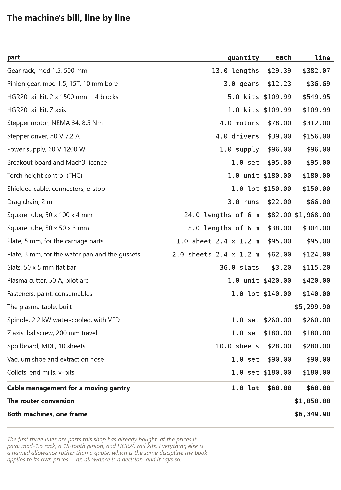

# 91. The Shop the Campaign Buys

*The machine those lines pay for, built rather than bought: a {{shop.travel_ft}} foot table for {{shop.build_usd}} dollars, and the router head that shares its frame*

The campaign's goal has two machine lines in it: {{shop.goal_plasma_usd}} for a
CNC plasma table and {{shop.goal_router_usd}} for a CNC router. Both are honest
numbers for *buying* those machines at the size this work needs.

This chapter is the other option, and it is the one a shop with a welder should
take: build the table from a published set of plans, then put a router head on
the same frame. The arithmetic lands at {{shop.build_usd}} for the plasma table
and {{shop.router_usd}} more for the router head -- {{shop.both_usd}} for both
machines, against the two lines' {{shop.goal_plasma_usd}} and
{{shop.goal_router_usd}}.

The design is the Homemade Madness DIY CNC plasma table, whose plans and cut
files this shop is working from, and the credit for it is theirs. The plans are
drawn for a two-by-one-metre sheet and say the machine can be built as big as
you like by two rules: the base frame is 250 millimetres longer and wider than
the largest sheet, and the gantry tube is 253 millimetres longer than the cut
width. Everything in this chapter is those two rules applied to a
{{plate.sheet_ft}} foot sheet, and then counted.

## The table, at ten feet

**The frame.** A base frame {{shop.frame_mm}} millimetres, in the plans'
50 x 50 x 3 box section (2 x 2 x 11 gauge), with legs and a water pan the size of
its inside. The plans' table is two metres long; this one is half again as
long, so it gets a leg pair and a cross member at mid-length -- the one change
this book makes to the design, so no rail span goes unsupported for more than
about 1.7 metres. A plasma table's accuracy is mostly its frame: square,
flat, parallel, and checked by its diagonals before anything is bolted to it.

**The gantry.** One {{shop.gantry_mm}} millimetre length of 100 x 50 x 3 tube
between two 5 mm plate sides, which the plans give as a cut list with paper
templates -- cut them by hand, or have them cut. Two HGR20 rails on its face
carry the torch carriage.

**The rails.** {{shop.rails}} rails in all -- a joined line along each long side
and two on the gantry -- which is {{shop.kits}} of the two-rail kits already
bought. The long sides take three rails each, joined end to end on a straight
edge. The plans are explicit that joined rails are fine and that alignment is
everything: mount the top rail first, then set the second parallel to it with
the moving carriage. The floating head's short rail is an offcut from the gantry.

**The rack.** Both long sides are driven, so both need rack: {{shop.x_racks}}
half-metre lengths a side, four on the gantry, and a spare --
**{{shop.racks}} lengths**. Each joint is cut at exactly the right tooth and
aligned with a short spare piece held across it. Racks sit 50 mm in from the
leg on the machine's home side.

**The pinions, and the number that has to be right.** Four pinions: two on the
long axis, one on the gantry, one spare. A 15-tooth mod 1.5 pinion has a
{{shop.pitch_dia_mm}} millimetre pitch diameter, so one motor turn moves an axis
{{shop.mm_per_rev}} millimetres -- with eight microsteps on a two-hundred-step
motor, **{{shop.steps_per_mm}} steps per millimetre**. That is the number Mach3
needs before anything is cut; get it wrong and every part comes out the wrong
size in a way that looks like a drawing error. The plans prefer a 13-tooth
pinion for torque and say plainly that whatever you find, you set the ratio in
software. Fifteen teeth is what was available; the machine does not care.

**The motors.** The pinions bought have a 10 mm bore, so the motor's shaft
must be 10 mm: a NEMA 23 of 3 newton-metres with a 10 mm shaft fits with no
sleeve. (A NEMA 34's 14 mm shaft would not.) Two of them on the long axis can
push the gantry -- about {{shop.gantry_kg}} kilograms, estimated -- at
{{shop.accel}} metres per second squared using only half their holding torque,
which is far more than a plasma, with no cutting force at all, ever asks for.

**The control and the torch.** Four DM556-class drivers, a 48-volt supply, the
plans' breakout board with a relay on the torch trigger, a Mach3 licence, and a
**pilot-arc** plasma with a CNC port: the plans warn that a high-frequency start
puts noise into the control wiring. A torch height controller is left out on
purpose -- the plans' board cannot run one, and the alternative they describe,
a floating head that touches off the plate again partway through a long cut,
costs nothing.

## What it costs, and what kind of number each price is

The bill keeps three kinds of price apart. **{{shop.parts_usd}} dollars** is what
this shop actually paid for rack, pinions and rail kits. **{{shop.quoted_usd}}**
is current retail listings, each named in the model. **{{shop.allowance_usd}}** is
still allowances -- estimates for steel, plate, the ballscrew and the wiring --
labelled as allowances until they are quoted.

    {{shop.bill}}

| | budgeted | built |
|---|---|---|
| CNC plasma table | {{shop.goal_plasma_usd}} | {{shop.build_usd}} |
| CNC router | {{shop.goal_router_usd}} | {{shop.router_usd}}, as a head on the same frame |
| **Both** | **{{shop.goal_plasma_usd}} + {{shop.goal_router_usd}}** | **{{shop.both_usd}}** |

Read as a shop decision rather than a saving, that difference is
{{shop.saving_both_usd}} dollars, and the campaign's own lines say where it
could go: the year of weather on a standing dome, the engineer, the first
quilters. Both choices are legitimate. The campaign's {{shop.goal_plasma_usd}}
buys a machine with support, a warranty and a phone number, which is worth real
money to somebody who is not a machinist. A built table takes weeks of
evenings, has no warranty, and its first troubleshooter is its owner.

## The router head

{{shop.router_usd}} on the same frame buys the machine this book's own method
wants. Everything between the floor and the gantry is shared -- the long axes,
the rack, the rails, the motors, the control. What changes is what touches the
work, and the bed under it:

* **A rigid Z** with a ballscrew in place of the floating head, because a router
  is asked to hold a few thousandths where a torch holds a sixteenth.
* **A spindle**, water-cooled, with its VFD -- quieter and stiffer than a trim
  router, and able to run for an hour without stopping.
* **A flat bed.** The water pan's slats lift out, and a support grid with an MDF
  spoilboard goes in, skimmed flat by the machine's own cutter so the bed is
  true to the gantry rather than to a level.
* **Dust extraction**, because wood dust and plasma sparks must never share a
  shop at the same time.
* **Cutters:** end mills for the jigs, V-bits for marking, and collets.

Is the plasma frame stiff enough to rout? The gantry tube, simply supported over
its length, sags less than a few hundredths of a millimetre under a 50 newton
side load at its middle -- less than a router's own runout. The weak point is
the rack's backlash, a tenth of a millimetre or so: fine for jigs and panels in
plywood, not for steel parts that fit like bearings.

## What the machine makes possible

Put this chapter next to the one before it and the argument completes itself.

**Steel vessels and steel shells.** Forty panels from one sheet make a
{{plate.diameter_ft}} foot vessel holding {{plate.gal}} gallons; a
{{plate.sweet_ft}} foot 3V dome in welded plate takes {{plate.sweet_sheets}}
sheets. That is a product the campaign can sell, and it exists because a plasma
table cuts plate the way a printer prints paper.

**And the jigs for the wooden version.** Every fixture this book describes -- the
bench jig, the stop blocks, the sled fence, the panel templates -- is a flat part.
A router cuts them accurately, repeatably, and in the time it takes to explain
what they should look like. The machine that cuts the steel also makes the shop
that cuts the wood.

The last word belongs to the plans the shop is working from, because their
advice is the advice this book gives about building: start with the frame, make
it straight, and expect the first machine to be a teacher rather than a
product.
